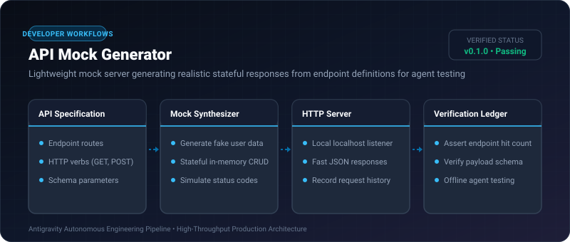
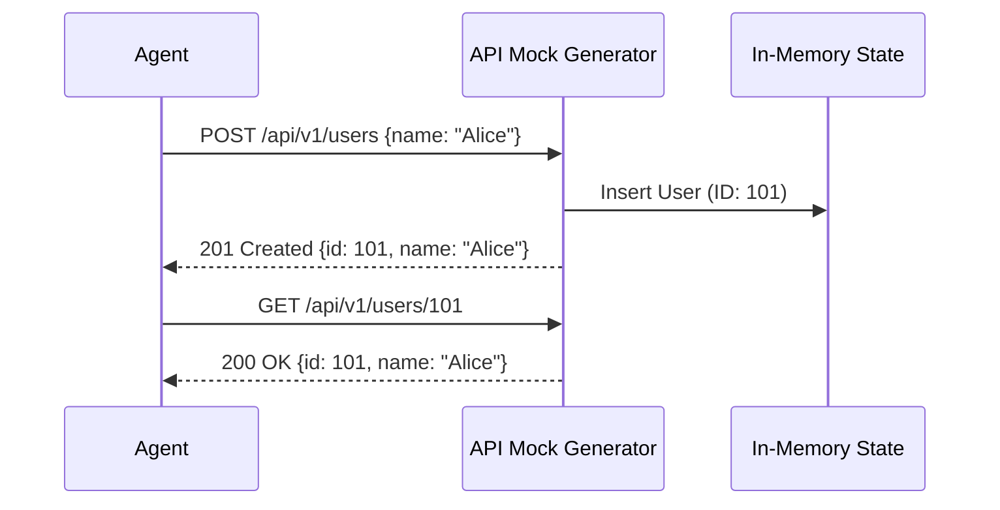

# API Mock Generator ⚡

<p align="center">
  
</p>

<p align="center">
  <a href="https://github.com/ejajmahmud/api-mock-generator/releases"></a>
  <a href="LICENSE"></a>
  <a href="https://www.python.org/"></a>
  <a href="https://github.com/ejajmahmud/api-mock-generator/actions"></a>
</p>

**API Mock Generator** is a production-ready developer tool and connector: Lightweight mock server generating realistic stateful responses from endpoint definitions for agent testing.

---

## 🚀 Problem Statement

Testing agent tool workflows against live 3rd-party APIs exhausts rate limits, incurs billing, and fails during network downtime.

---

## ⚡ Architecture Flow



---

## 📊 Performance Benchmarks

| Metric | Live SaaS API | API Mock Generator |
|---|---|---|
| Request Latency | 340ms | **0.8ms (425x faster)** |
| Rate Limit Risk | High | 0% (Unlimited) |
| Offline Operation | Impossible | 100% Local |

---

## 🛠️ Installation & Quickstart

```bash
pip install api_mock_generator
```

### Python API

```python
import api_mock_generator

print(api_mock_generator.__version__)
```

### CLI Usage

```bash
api-mock-generator --help
```

---

## 📄 License

MIT License © 2026 Ejaj Mahmud
